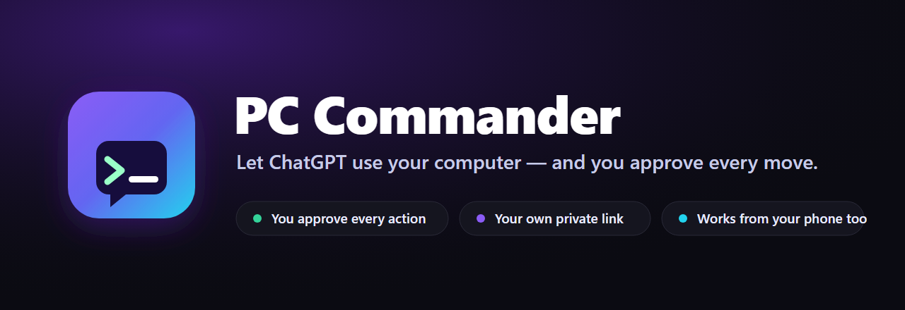
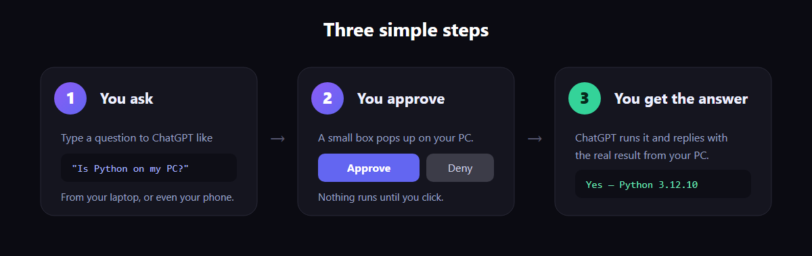
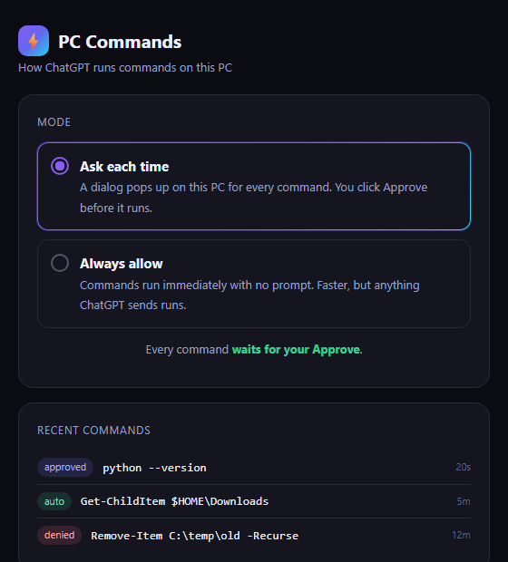

<div align="center">



<br>


### Ask ChatGPT to do something on your computer, and it actually does it — after you tap **Approve**.

</div>

---

## 👋 What is this, in plain words?

You know how ChatGPT can *tell* you how to do things on your computer, but can't actually **do** them? This fixes that.

**PC Commander is like a remote control for your PC that ChatGPT can use — except you're always holding the "Approve" button.**

Ask ChatGPT *"is Python installed on my computer?"* and instead of guessing, it checks **your** PC and tells you the real answer. Ask it to *"clean up my Downloads folder"* and it does — right after a little box pops up on your screen and you click **Approve**.

Nothing ever happens on your computer unless **you** allow it.

<div align="center">

</div>

---

## 💡 Things you can ask it

Once it's set up, just chat normally. For example:

- *"Is Python (or Node, or Git) installed on my PC?"*
- *"What's taking up all the space on my hard drive?"*
- *"Clean up my Downloads folder — delete anything older than a month."*
- *"What's my computer's IP address and Windows version?"*
- *"Make a folder on my Desktop called Taxes and move all my PDFs into it."*
- *"Is my laptop running hot? What's using the most memory right now?"*
- *"What's on my screen right now?"* — it can actually **take a screenshot and look**.

It can do basically anything you could type into your PC yourself — you just approve it first.

---

## 🧰 What it can do

PC Commander gives ChatGPT a real toolbox, not just a command line. Each tool is colour‑coded by how careful it is:

🟢 **reads** (runs instantly, never changes anything) · 🟡 **changes files** (asks first) · 🔵 **runs / launches** (asks first)

| Tool | What it does | |
|---|---|---|
| `read_file` | Read any text file | 🟢 |
| `list_dir` | List what's in a folder | 🟢 |
| `find_files` | Find files by name (e.g. all your PDFs) | 🟢 |
| `search_in_files` | Search *inside* files for text | 🟢 |
| `system_info` | OS, CPU, RAM, disk space, uptime | 🟢 |
| `list_processes` | What's running / using memory | 🟢 |
| `write_file` | Create or overwrite a file | 🟡 |
| `edit_file` | Find‑and‑replace inside a file | 🟡 |
| `manage_path` | Make / move / copy / delete files & folders | 🟡 |
| `run_command` | Run any PowerShell command (anything above + more) | 🔵 |
| `open_path` | Open a file, folder, app, or website | 🔵 |
| `kill_process` | Stop a frozen or unwanted program | 🔵 |
| `screenshot` | Capture the screen so ChatGPT can **see** it | 🔵 |

> By default, 🟢 reads happen instantly (they're harmless) while 🟡/🔵 actions wait for your **Approve** — so ChatGPT can freely *look around*, but never *change* anything without your okay. Switch to **Always allow** on the settings page for fully hands‑off.

---

## ✅ What you'll need

| | |
|---|---|
| 🖥️ **A Windows PC** | The computer you want to control. (You can *talk* to it from your phone or a Mac — but the computer being controlled has to be Windows.) |
| ⏱️ **About 10 minutes** | One-time setup. After that it runs by itself. |
| 💬 **A ChatGPT account** | One that lets you add "connectors" (a connector is just a plug-in that lets ChatGPT talk to your PC). |
| 🌐 **A website address you own** *(optional)* | If you have one (like `yourname.com`), you get a permanent link that never changes. No domain? You can still use the free temporary option. |

> **Never set anything like this up before?** That's fine. Every step below is copy‑paste. You don't need to understand the commands — just follow along.

---

## 🚀 Setting it up

> **How to open "PowerShell"** (you'll need it below): press the **Start** button, type **PowerShell**, and press **Enter**. A blue window opens. That's where you paste the commands.

### Step 1 — Get the files onto your PC

In PowerShell, paste this and press Enter:

```powershell
git clone https://github.com/Lucifer-xD/pc-commander.git
cd pc-commander
```

<sub>💡 If it says "git is not recognized", install **[Git](https://git-scm.com/download/win)** first (click Next through the installer), then try again. You'll also need **[Node.js](https://nodejs.org)** — download the big green "LTS" button and install it.</sub>

### Step 2 — Run the installer

Paste this:

```powershell
powershell -ExecutionPolicy Bypass -File scripts\install.ps1
```

This sets everything up and makes it **start automatically every time you turn your PC on**. When it finishes, it prints a link ending in a long code — that long code is **your private key**. Keep that window open for the next step.

### Step 3 — Get your link

ChatGPT needs a web address to reach your PC. Pick one:

<table>
<tr>
<td width="50%" valign="top">

**🅰️ Just trying it out?**

```powershell
npm run quick
```

Gives you a **temporary** link right away. Good for a first test. (The link changes each time, so it's not for everyday use.)

</td>
<td width="50%" valign="top">

**🅱️ Want it permanent? (recommended)**

```powershell
powershell -ExecutionPolicy Bypass -File scripts\setup-domain.ps1 -Hostname pc.yourdomain.com
```

Uses a website address you own to make a **permanent link that never changes**. A browser opens once to sign in — just follow the prompts.

</td>
</tr>
</table>

Either way, you'll get a link that looks like this — **copy it**, you'll paste it into ChatGPT next:

```
https://pc.yourdomain.com/mcp?key=your-long-private-code
```

### Step 4 — Connect it to ChatGPT

1. Go to **chatgpt.com** → click your name → **Settings** → **Connectors**.
2. Click **Add custom connector** (you may first need to turn on *Advanced → Developer mode*).
3. Fill in the boxes:

   | Box | What to put |
   |---|---|
   | **Name** | `PC Commander` |
   | **Description** | `Securely run things on my own Windows PC. I approve each action.` |
   | **URL** | the link you copied in Step 3 |
   | **Authentication** | choose **No authentication** *(your key is already in the link)* |
   | **Icon** | pick the file `assets/icon-connector.png` from this folder |

4. Tick **"I trust this application"** and click **Create**.
5. Start a **new chat**, click the **➕** near the message box, and make sure **PC Commander** is switched **on**.

🎉 **Try it:** type *"using PC Commander, what's my Windows version?"* — a box pops up on your PC, you click **Approve**, and the answer appears in the chat.

### Step 5 — Make ChatGPT use it automatically

So you don't have to say "use PC Commander" every time, give ChatGPT a standing instruction.

Go to **Settings → Personalization → Custom Instructions**, and in the box that says *"How would you like ChatGPT to respond?"*, paste this:

```text
I have a connector called PC Commander that runs things on my own Windows PC.
Whenever I ask about my PC / computer / laptop — checking if something is
installed, running something, finding or tidying files, system info, and so on
— use PC Commander directly and tell me the result, right here in the chat.
Don't tell me to do it myself, and don't switch me to "Work" or "Agent" mode —
stay in the normal chat. Every action already asks me to approve it on my PC.
```

<sub>📱 **Using the ChatGPT desktop app too?** Do the same thing there under *Settings → Personalization → Custom instructions*. The app and the website remember these separately, so paste it in both.</sub>

**That's it — you're done.** From now on, just ask ChatGPT about your computer and it'll handle it.

---

## 🎚️ How careful should it be?

You decide how much it asks before doing things. Open the settings page (the installer put a shortcut on your Desktop, or use the `http://127.0.0.1:8787/...` link from Step 2):

<div align="center"></div>

- **Ask each time** *(safest, recommended)* — a box pops up for every single action and waits for your **Approve**. Nothing runs until you click.
- **Always allow** *(hands-off)* — things run instantly with no pop-up. Faster, but it will do **whatever** ChatGPT asks. Only use this when you're watching.

You can switch between them anytime, and it takes effect on the very next request.

<details>
<summary><b>One more thing: ChatGPT might also ask its own "allow?" question</b></summary>

<br>

There are two separate "are you sure?" checks, and that's on purpose:

1. **Your PC's pop-up** (the one above) — the main safety net. Always protects you.
2. **ChatGPT's own prompt** — the first time, ChatGPT may ask *"allow PC Commander to run this?"*. Choose **Always allow** there to stop being asked. (On the desktop app this lives under *Settings → Personalization → Permissions → Custom rules*.)

**Want zero interruptions?** Set both to allow. **Want maximum safety?** Leave both on ask.

</details>

---

## 🔐 Is this safe?

Yes — and here's why, in plain terms:

- **You approve everything.** Even if someone somehow got your link, nothing would run on your PC until *you* clicked Approve on your own screen.
- **Only you have the link.** It contains a long secret code. Don't share it or post it anywhere, and you're the only one who can get in.
- **It's your computer, your rules.** It only listens to your private link — it's not open to the internet, and there are no doors left unlocked.
- **Everything is written down.** Every request and your decision is saved in a log file on your PC, so you can always see what happened.

> Think of **"Always allow"** like handing someone your keyboard — only turn it on when you're paying attention. The rest of the time, keep **"Ask each time"** on.

---

## ❓ It's not working — help

| What you're seeing | What to do |
|---|---|
| ChatGPT says *"handoff was declined"* | You didn't click **Approve** in time (it waits about a minute). Try again and click it, or switch to **Always allow**. |
| It keeps saying *"Continue in Work"* | Make sure **PC Commander** is switched on in the ➕ menu, add the Step 5 instruction, and click **"Stay in Chat"**. Tip: starting your message with **@PC Commander** forces it. |
| *"git is not recognized"* / *"node is not recognized"* | Install **[Git](https://git-scm.com/download/win)** and **[Node.js](https://nodejs.org)**, then close and reopen PowerShell. |
| Nothing works after I restarted my PC | It should start on its own. If not, press **Start**, type `shell:startup`, Enter — you should see **PC Commander** shortcuts there. |
| I want a new secret code | Delete the file `data\token.txt`, restart your PC, and update the link in ChatGPT with the new one. |

Still stuck? [Open an issue](https://github.com/Lucifer-xD/pc-commander/issues) and describe what happened.

---

<details>
<summary><b>🧩 For developers (the technical bits)</b></summary>

<br>

PC Commander is a small [Model Context Protocol](https://modelcontextprotocol.io) server exposing one tool, `run_command`, over streamable HTTP. The server binds to `127.0.0.1` only; a Cloudflare named tunnel provides the public HTTPS hostname. Requests carry a token (`?key=` or Bearer); each command passes an approval gate (a topmost WinForms dialog) unless mode is `always`.

```
src/
  server.mjs      MCP server; run_command tool; /health, settings + mode API
  exec.mjs        runs a command in PowerShell, captures stdout/stderr/exit code
  approve.mjs     spawns the approval dialog; returns approved/denied/timeout
  approve.ps1     the topmost Approve/Deny dialog with a countdown
  config.mjs      defaults + generates data/token.txt
  log.mjs         JSONL logging
  run.mjs         quick-start launcher (server + temporary tunnel)
  settings.html   the Ask / Always-allow page
scripts/
  install.ps1       deps + key + auto-start the server at logon
  setup-domain.ps1  named Cloudflare tunnel + permanent URL + auto-start the tunnel
  autostart/*.vbs   windowless launchers used by the Startup shortcuts
cloudflared/
  pc-commands.example.yml   template (your real one is generated & gitignored)
```

Run `npm start` to launch just the server, `npm run quick` for server + temporary tunnel. PRs welcome.

</details>

<div align="center">
<br>
<sub>MIT License · Made for anyone who'd rather just <i>ask</i> their computer.</sub>
</div>
