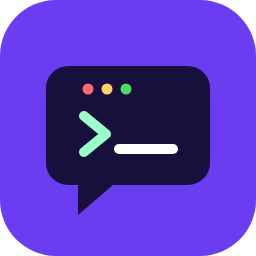
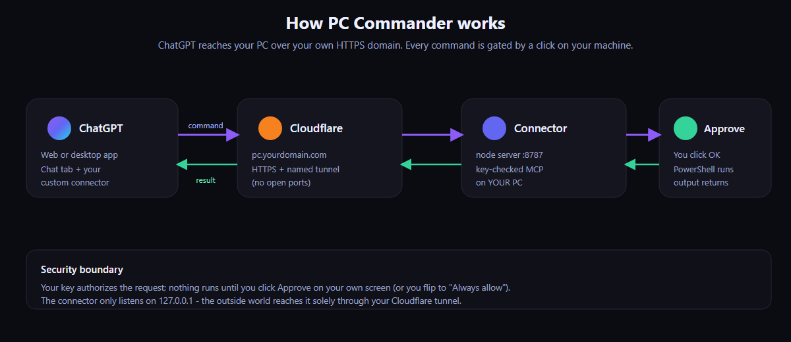

<div align="center">



# PC Commander

**Run commands on your own PC straight from ChatGPT — over your own private HTTPS URL, with a one-click approval on your machine.**

Ask ChatGPT *"is Python installed on my device?"* or *"what's eating my disk?"* and it actually checks **your** computer and answers — no copy‑pasting commands into a terminal.



</div>

---

## Contents

- [What it is](#what-it-is)
- [Requirements](#requirements)
- [1 · Install (2 minutes)](#1--install-2-minutes)
- [2 · Put it online](#2--put-it-online)
  - [Option A — temporary URL (just trying it)](#option-a--temporary-url-just-trying-it)
  - [Option B — permanent URL on your own domain](#option-b--permanent-url-on-your-own-domain-recommended)
- [3 · Add it to ChatGPT](#3--add-it-to-chatgpt)
- [4 · Make ChatGPT always use it (and stay in Chat)](#4--make-chatgpt-always-use-it-and-stay-in-chat)
- [The settings page (Ask vs Always‑allow)](#the-settings-page-ask-vs-always-allow)
- [Your key](#your-key)
- [Security](#security)
- [Troubleshooting](#troubleshooting)
- [How it's built](#how-its-built)

---

## What it is

A tiny self‑hosted **MCP connector**. It runs a small Node server on your PC that exposes **one tool — `run_command`** — which runs PowerShell and returns the output. You add it to ChatGPT as a **custom connector**, and from then on ChatGPT can act on your machine.

The important part: **nothing runs without your say‑so.** Every command pops an **Approve / Deny** dialog on your own screen (you can switch to "always allow" when you want it hands‑off). The server only listens on `127.0.0.1`; the outside world reaches it **only** through a Cloudflare tunnel you control, and only with your secret key.

> **Platform:** the controlled machine must be **Windows** (it uses PowerShell). You can *drive* it from ChatGPT on any device — phone, Mac, web.

**Highlights**

- 🔒 **Approval gate** — a click on your PC is the real security boundary, even if the key leaks.
- 🌐 **Permanent URL** — your own `pc.yourdomain.com` that never changes, via a free Cloudflare tunnel. No open ports, no port‑forwarding.
- ⚡ **Auto‑start** — launches silently at every logon; survives sleep/wake.
- 🎚️ **Live mode toggle** — flip Ask ↔ Always‑allow from a local web page, anytime.
- 🧩 **No third‑party relay** — unlike hosted alternatives, your commands go through *your* domain and *your* server only.

---

## Requirements

- **Windows 10/11** (the PC you want to control).
- **[Node.js](https://nodejs.org) 20+** (LTS is fine).
- For the permanent URL: a domain whose DNS is on **[Cloudflare](https://dash.cloudflare.com)** (free plan works) and **[cloudflared](https://github.com/cloudflare/cloudflared/releases)** (the setup script can install it for you).
- A ChatGPT account that can add **custom connectors** (custom MCP servers).

---

## 1 · Install (2 minutes)

```powershell
git clone https://github.com/Lucifer-xD/pc-commander.git
cd pc-commander
powershell -ExecutionPolicy Bypass -File scripts\install.ps1
```

The installer:

1. installs dependencies,
2. generates your **private key** (`data\token.txt`),
3. sets the server to **auto‑start at every logon** (a shortcut in your Startup folder — no admin needed),
4. starts it now and prints your **local settings URL**.

You'll see something like:

```
Settings page (change Ask / Always-allow):
  http://127.0.0.1:8787/?key=xxxxxxxxxxxxxxxxxxxxxxxxxxxxxxxx
```

Keep that key handy — it's the same key used in your ChatGPT URL below.

---

## 2 · Put it online

ChatGPT lives on the internet, so it needs a public HTTPS URL that forwards to your PC. Pick one:

### Option A — temporary URL (just trying it)

```powershell
npm run quick
```

This opens a free tunnel and prints a ready‑to‑paste URL like
`https://abcd1234.lhr.life/mcp?key=...`. Good for a first test. **The URL changes every run**, so it's not for daily use — leave the window open while you use it.

### Option B — permanent URL on your own domain (recommended)

One command, using your Cloudflare domain:

```powershell
powershell -ExecutionPolicy Bypass -File scripts\setup-domain.ps1 -Hostname pc.yourdomain.com
```

It logs cloudflared into your Cloudflare account (a browser opens once), creates a **named tunnel**, points `pc.yourdomain.com` at it, writes the config, **auto‑starts the tunnel at logon**, and prints your **permanent URL**:

```
Paste THIS into ChatGPT as the connector URL:
  https://pc.yourdomain.com/mcp?key=xxxxxxxxxxxxxxxxxxxxxxxxxxxxxxxx
```

This URL **never changes again** — paste it into ChatGPT once and you're done forever.

<details>
<summary>Prefer to do it by hand? (click)</summary>

```powershell
cloudflared tunnel login                       # authorize your domain
cloudflared tunnel create pc-commands           # note the UUID it prints
cloudflared tunnel route dns pc-commands pc.yourdomain.com
# copy cloudflared\pc-commands.example.yml to cloudflared\pc-commands.yml,
# fill in the UUID / credentials path / hostname, then:
cloudflared tunnel --config cloudflared\pc-commands.yml run
```
Add `protocol: http2` in the yml if your network blocks QUIC (common on office/mobile Wi‑Fi).
</details>

> **Tip:** test any time with `curl https://pc.yourdomain.com/health` → `{"ok":true,...}`.

---

## 3 · Add it to ChatGPT

> Custom connectors are added on the **web** (`chatgpt.com`); once added they're available to your account. You may need **Settings → Connectors → Advanced → Developer mode** turned on to add a custom one.

1. **Settings → Connectors → Add custom connector** (a.k.a. *Add custom MCP server*).
2. Fill in:

   | Field | Value |
   |---|---|
   | **Name** | `PC Commander` |
   | **Description** | `Securely run commands on my own Windows PC through a private, self-hosted bridge. Every command is gated by an on-device approval prompt (toggleable to auto-allow).` |
   | **MCP Server URL** | `https://pc.yourdomain.com/mcp?key=YOUR_KEY` |
   | **Authentication** | **No authentication** *(the `?key=` in the URL is the auth)* |
   | **Icon** | `assets/icon-connector.png` (in this repo) |

3. Check "I trust this application" → **Create**.
4. In a new chat, open the **`+` / tools menu** and make sure **PC Commander** is toggled **on**.
5. Ask it something: *"using PC Commander, what's my Windows version?"* → an **Approve** box appears on your PC → click it → the answer comes back in chat. 🎉

---

## 4 · Make ChatGPT always use it (and stay in Chat)

By default ChatGPT may try to push you into **Work/Agent mode** for "device" tasks. To make it just use the connector in the **Chat** tab without being told each time, add a standing instruction.

**On the web:** *Settings → Personalization → Custom Instructions* → **"How would you like ChatGPT to respond?"**
**In the desktop app:** *Settings → Personalization → Custom instructions → Codex instructions* (this edits the `AGENTS.md` file for the machine).

Paste this into **both** (instructions don't carry between the web and the app):

```markdown
# My machine & PC Commander

I have a connector called **PC Commander** with a `run_command` tool
that runs PowerShell on my own Windows PC. It is authorized by me, and
every command is gated by my own approval (or auto-allowed when I choose).
I am fully able to act on my device through it.

Always follow these rules:
- For ANY request about my PC / computer / laptop / device / "this machine"
  — is X installed, run a command or script, read/list/edit files, git,
  builds, tests, system info, install or launch apps — call PC Commander's
  `run_command` tool and report the result, here in Chat.
- NEVER suggest, offer, or switch me to "ChatGPT Work", Agent mode, or
  Tasks. Stay in Chat. If a "Continue in Work" card appears, ignore it and
  use PC Commander instead.
- NEVER tell me to open a terminal and run things myself, and never say you
  can't reach my device — you can, via PC Commander.
- Don't ask me to confirm in chat; the local approval prompt handles that.
```

If a **"Continue in Work"** card still pops up on the first turn, click **Stay in Chat**. Tagging **`@PC Commander`** at the start of a message forces it 100% of the time.

---

## The settings page (Ask vs Always‑allow)

Open `http://127.0.0.1:8787/?key=YOUR_KEY` on the PC (the installer also drops a shortcut). Flip the mode live — it takes effect on the very next command.

<div align="center"></div>

- **Ask each time** — a dialog pops on your PC for every command; you click **Approve**. (If you don't click in ~55 s it's treated as declined and the command does **not** run.)
- **Always allow** — commands run immediately, no prompt. Faster and fully hands‑off, but **anything** ChatGPT sends will run. Use it when you trust the session.

The page also shows your recent commands and how each was decided (auto / approved / denied).

---

## Your key

- It's a random 48‑char token in `data\token.txt`, generated on first run. It's your password — **anyone with the full URL can reach your PC** (still gated by the Approve prompt while in "Ask" mode).
- **Never commit it or post it publicly.** It's gitignored here.
- **Rotate it** anytime: delete `data\token.txt`, restart the server (a new one is generated), and update the URL in your ChatGPT connector.

---

## Security

- The Node server binds to **`127.0.0.1` only** — it is never directly exposed. The Cloudflare tunnel is the sole way in, and it requires your key.
- The **Approve dialog is the real boundary.** Even if your key leaks, nothing executes until someone clicks Approve on your physical screen — unless you deliberately set "Always allow".
- Everything is logged to `logs\connector.log` (requests, decisions, results).
- This tool gives ChatGPT real power over your machine. Keep "Ask" mode on unless you're actively supervising, and treat "Always allow" like handing over your keyboard.

---

## Troubleshooting

| Symptom | Fix |
|---|---|
| ChatGPT says *"handoff was declined"* | You didn't click **Approve** in time (or denied it). Approve faster, or switch to **Always allow** on the settings page. |
| It keeps offering **"Continue in Work"** | Make sure the connector is toggled **on** in the chat's `+` menu, add the custom instruction above, and click **Stay in Chat**. |
| `health` works but `/mcp` is 401 | The `?key=` in your URL doesn't match `data\token.txt`. Copy it again from the settings line. |
| Tunnel won't connect / QUIC errors | Add `protocol: http2` to `cloudflared\pc-commands.yml` and restart the tunnel. |
| Nothing starts after reboot | Check the two shortcuts in `shell:startup` (`PC Commander Server` / `PC Commander Tunnel`). Node and cloudflared must be on your PATH. |
| `cloudflared` not found | `winget install --id Cloudflare.cloudflared`, then reopen PowerShell. |

---

## How it's built

```
src/
  server.mjs      MCP streamable-HTTP server; the run_command tool; /health, settings + mode API
  exec.mjs        runs a command in PowerShell, captures stdout/stderr/exit code
  approve.mjs     spawns the approval dialog; returns approved/denied/timeout
  approve.ps1     the topmost WinForms Approve/Deny dialog with a countdown
  config.mjs      defaults + generates data/token.txt
  log.mjs         JSONL logging
  run.mjs         quick-start launcher (server + temporary tunnel)
  settings.html   the Ask / Always-allow page
scripts/
  install.ps1       deps + key + auto-start the server
  setup-domain.ps1  named Cloudflare tunnel + permanent URL + auto-start the tunnel
  autostart/*.vbs   windowless launchers used by the Startup shortcuts
cloudflared/
  pc-commands.example.yml   template (your real one is generated & gitignored)
assets/           icons + docs images
```

Built on the [Model Context Protocol](https://modelcontextprotocol.io). PRs welcome.

## License

MIT © Lucifer-xD
